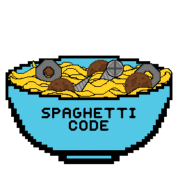

<div align="center">
  

  # FTC Team 39068 "Spaghetti code" 🍝

  
  
  
  

  
  
  
  
  

  <p>Official robot control software repository for <b>FTC Team 39068 "Spaghetti code"</b>, based at <b>Pembrokeshire College</b> in Wales, UK. Competing in the <b>2026–2027 FIRST Tech Challenge BIOBUZZ Season</b>.</p>
</div>

---

## 📋 Table of Contents
- [About Team 39068](#-about-team-39068)
- [Robot Hardware & Subsystems](#-robot-hardware--subsystems)
- [Software Architecture & Features](#-software-architecture--features)
- [TeleOp Driver Controls](#-teleop-driver-controls)
- [Autonomous & Vision System](#-autonomous--vision-system)
- [Project Structure](#-project-structure)
- [Getting Started & Deployment](#-getting-started--deployment)
- [Sponsors & Support Us](#-sponsors--support-us)
- [Team Roster & Credits](#-team-roster--credits)
- [Contact & Inquiries](#-contact--inquiries)

---

## 🍝 About Team 39068

Founded in 2026, **Team 39068 "Spaghetti code"** is a student-led robotics team from **Pembrokeshire College** in Wales, UK. As a team composed heavily of passionate programmers and makers, our name pays homage to software development culture with a touch of humor. 

2026–2027 marks our **Rookie Year** in the FIRST Tech Challenge!

> [!NOTE]
> As a rookie team built from the ground up by students, we are actively learning and expanding our custom software stack, integrating motion profiling, computer vision, and closed-loop motor control.

---

## 🤖 Robot Hardware & Subsystems

| Subsystem | Hardware Specs & Configuration |
| :--- | :--- |
| **Drivetrain** | Differential **Tank Drive** layout. *(Future goal: Upgrading to a Mecanum Drive once kit funding is secured!)* |
| **Intake** | Active Roller Intake with a servo-driven deployment mechanism that starts folded to pass the 18" sizing inspection and deploys in-game. |
| **Launcher** | Flywheel Launcher powered by a high-speed `DcMotorEx` using closed-loop PIDF velocity control for consistent shot trajectory. |
| **Sensors** | Motor-integrated wheel encoders + **Logitech C270 Webcam** for computer vision. |
| **Control System** | REV Control Hub + REV Driver Hub. |

> [!IMPORTANT]
> **Expansion Rule Compliance:** The roller intake mechanism starts folded to fit inside the standard 18" x 18" x 18" sizing cube. Upon match start, a servo releases/deploys the intake outward for game element acquisition.

---

## 💻 Software Architecture & Features

Our codebase is built on Java using the official FTC SDK and integrates modern robotics control software:

- **Road Runner 1.0 (`BiobuzzAutonomous`):** Trajectory generation and motion planning tailored for our Tank Drive setup.
- **OpenCV Color Blob Detection (`AutoAlignToColorOpMode`):** Vision portal processing using `ColorBlobLocatorProcessor` to automatically detect and align with yellow **Pollen** and red/blue **Nectar** targets.
- **Closed-Loop Velocity PIDF (`HumanDrivenOpMode`):** Custom PIDF velocity algorithm with feedforward (`F`) and anti-windup bounds for launcher accuracy.
- **FTC Dashboard Integration:** Real-time telemetry streaming, live webcam feed (30 FPS), and on-the-fly parameter tuning accessible at `http://192.168.43.1:8080/dash`.
- **Roadmap / Pedro Pathing Migration:** Software infrastructure ready for **Pedro Pathing** and custom localizers (Pinpoint, OTOS, Dead Wheels) as soon as the Mecanum hardware upgrade is completed.

> [!TIP]
> **Live Parameter Tuning:** When connected to the Control Hub's Wi-Fi network, navigate to `http://192.168.43.1:8080/dash` to view real-time flywheel launcher velocity graphs, edit PIDF coefficients live, and inspect camera streams at 30 FPS.

---

## 🎮 TeleOp Driver Controls

TeleOp is mapped for single-driver operation on **Gamepad 1** (`HumanDrivenOpMode`):

### Mapping Table
| Input | Mechanism / Action |
| :--- | :--- |
| `Left Joystick Y` | Drive Forward / Backward |
| `Left Joystick X` | Turn Left / Right |
| `Cross (X)` | Toggle Roller Intake ON / OFF |
| `Square ([])` | Toggle Intake Deployment Servo (Up / Down) |
| `D-Pad Up` | Increase Launcher Flywheel Speed (`Off` $\rightarrow$ `Low (1500 RPM)` $\rightarrow$ `High (3000 RPM)`) |
| `D-Pad Down` | Decrease Launcher Flywheel Speed (`High` $\rightarrow$ `Low` $\rightarrow$ `Off`) |

---

## 🎯 Autonomous & Vision System

### 1. Road Runner Autonomous (`BiobuzzAutonomous.java`)
Executes sequential action trajectories for pre-load scoring and positional alignment during the 30-second autonomous period.

### 2. Vision Auto-Align Pipeline (`AutoAlignToColorOpMode.java`)
Uses OpenCV `ColorBlobLocatorProcessor` to detect game elements in real-time via the Logitech C270 camera:
- **Pollen Target:** Yellow color blob detection with circularity filtering ($0.60 - 1.0$).
- **Nectar Target:** Red and Blue color blob locator.
- **Init Selection:**
  - `Cross`: Target Yellow Pollen
  - `Circle`: Target Red Nectar
  - `Square`: Target Blue Nectar
  - `Triangle`: Target Any Largest Target

---

## 📁 Project Structure

```
pedro-pathing--spaghetti-code/
├── TeamCode/                        # Custom OpModes, Autonomous, Localizers & Tuning
│   └── src/main/java/org/firstinspires/ftc/teamcode/
│       ├── HumanDrivenOpMode.java   # Main TeleOp control & PIDF Flywheel launcher
│       ├── BiobuzzAutonomous.java   # Road Runner 1.0 Autonomous routine
│       ├── AutoAlignToColorOpMode.java # OpenCV vision-based target alignment
│       ├── TankDrive.java           # Road Runner Tank Drive kinematics
│       ├── MecanumDrive.java        # Mecanum Drive kinematics (future hardware)
│       ├── PinpointLocalizer.java   # gobilda Pinpoint localizer integration
│       ├── OTOSLocalizer.java       # SparkFun OTOS localizer integration
│       ├── messages/                # Road Runner telemetry & tuning logs
│       └── tuning/                  # Tuning OpModes & localization tests
├── FtcRobotController/              # FTC Robot Controller core module
├── FtcDashboard/                    # Dashboard live telemetry & camera streaming
├── logo.png                         # Team 39068 Official Logo
└── README.md                        # Project documentation
```

---

## 🚀 Getting Started & Deployment

### Prerequisites
- **Android Studio Narwhal (2023.3.1)** or newer.
- **JDK 17** configured in Android Studio.
- FTC Driver Hub / Control Hub running official FTC Robot Controller App v9.0+.

### Building & Deploying
1. Clone this repository:
   ```bash
   git clone https://github.com/oliver-lebaigue-bright-bench/pedro-pathing--spaghetti-code.git
   ```
2. Open the project directory in Android Studio.
3. Connect your computer to the Control Hub via a USB-C or micro cable.
4. Select the `:TeamCode` run configuration in the top toolbar.
5. Click **Run** (`Shift + F10`) to compile and deploy to the Control Hub.

---

## 🤝 Sponsors & Support Us

As a **rookie team with limited funds**, we are incredibly grateful for the support of our founding sponsors who made our rookie season possible:

- 🛠️ **[iFixit](https://www.ifixit.com/)** – Providing quality repair tools & hardware support.
- 🎓 **[Pembrokeshire College](https://www.pembrokeshire.ac.uk/)** – Educational support, facility access, and team sponsorship.

> [!IMPORTANT]
> 📢 **Support Team 39068!** We are actively seeking sponsors and community partners to help us fund hardware upgrades (such as a Mecanum drive kit, odometry modules, and custom machined parts). If you or your organization would like to support us, please reach out at [oliverlebaigue@gmail.com](mailto:oliverlebaigue@gmail.com).

---

## 👥 Team Roster & Credits

### Team Leads
- 👩‍🏫 **Alison Whitehurst** – Team Lead
- 👨‍🏫 **Eben Sky** – Team Lead

### Student Team
| Name | Role(s) |
| :--- | :--- |
| **Oliver** | Team Manager • Build Team • Software Engineer |
| **Eli** | Team Manager • Software Engineer |
| **Charlie** | Lead Driver |
| **Oakley** | Build Team • Electrics |
| **Tien Le** | Strategy Lead |
| **Iestyn** | Finance Lead |
| **Sam** | Social Media |
| **Osian** | Digital Media (Team Logo & Graphics) |
| **Dawid** | Documentation (Makerspace) |

---

## ✉️ Contact & Inquiries

For sponsorship inquiries, outreach opportunities, or technical questions, feel free to contact us:

- 📧 **Email:** [oliverlebaigue@gmail.com](mailto:oliverlebaigue@gmail.com)
- 🏫 **Location:** Pembrokeshire College, Wales, United Kingdom
- 🤖 **FIRST Team Number:** FTC 39068
